  

    

  
  
  
  

  

<h2 align="center">⟨ Tech Stack /⟩</h2>

  <code>LANGUAGES</code> 
    

  <code>FRONTEND</code> 
    

  <code>BACKEND &amp; DATA</code> 
    

  <code>DESKTOP · MOBILE · DEVOPS</code> 
  

<h2 align="center">⟨ Telemetry /⟩</h2>

  
  
   
  
   
  

<h2 align="center">⟨ Contributions /⟩</h2>

 

